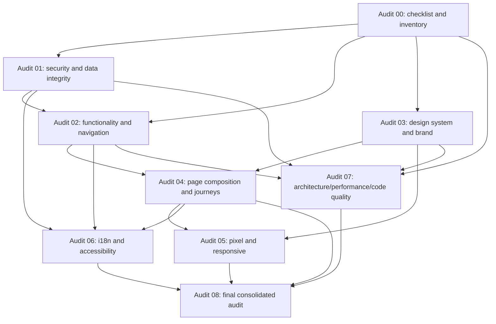

# HudaVerse — Audit 00: Master Audit Checklist

**Audit date:** 2026-11-09 (Asia/Dhaka)  
**Program status:** Preparation only; the eight downstream audits have not been completed.  
**Audit 00 write scope:** This file only. No application source, configuration, locale, asset, or other audit file was modified.

## 1. Purpose and scope

Audit 00 organizes the priority-based audit program, records the prior findings that can be recovered from the user-provided Phase 1/Phase 2 report text, inventories the current repository, and establishes per-file inspection status without equating a listing/search with review.

The previous audit reports were deleted from `docs/audits` at the user's explicit request in this conversation. The user then pasted the Phase 2 report and supplied the Audit 00 instruction text. The full Phase 1/Phase 2 files and their original per-file appendices are not present in the current filesystem. Prior finding IDs and summary statuses below are reconstructed from that pasted material. Per-file Phase 1 status mapping is therefore **not recoverable**; no path is assigned a prior status by guesswork.

Audit 00 does not implement, fix, redesign, run tests/build/lint, or claim a completed project audit. In this correction pass, all 5,942 lines of root `AGENTS.md` were read in consecutive chunks from beginning to end; no source keyword search or generated summary was used as a substitute. The inventory was compared against the current filesystem: after excluding this report itself and generated/dependency/temp folders, there are 198 paths, with zero missing, extra, or duplicate paths. Two instruction/inventory documents were directly reviewed in full (`AGENTS-02.md`, `STRUCTURE.md`); `AGENTS.md` was fully reviewed for this correction. No application source file was directly inspected as part of Audit 00. A browser host was unavailable during the preceding Phase 2 attempt; that evidence is historical and is not treated as a present-day browser check.

## 2. Governing documentation and conflicts

1. Root `AGENTS.md` is the Official Master Blueprint v2.0 FINAL and the highest project/product authority. It includes the unified Public Web Visual & UX Constitution. Its locked architecture, palette, typography, security, and product scope govern.
2. `AGENTS-02.md` is supporting guidance and expressly defers to `AGENTS.md` when they conflict.
3. `STRUCTURE.md` is a filesystem/status inventory, not authority to alter the Blueprint.
4. There are no remaining files under `docs/` at the time of this inventory; the prior audit reports were deleted. Thus there is no separate checked-in design/architecture doc to read in Audit 00. Visual direction and architecture requirements are embedded in `AGENTS.md`.
5. The user supplied the prior Phase 2 report text in chat. Its claims are evidence of what the preceding audit recorded, not a substitute for the deleted source report or independent current verification.

### Document conflicts to carry forward

| Topic | Higher-priority instruction | Supporting/current inventory conflict | Audit treatment |
|---|---|---|---|
| Landing Download | The latest public-web direction in `AGENTS.md` approves the Landing sequence Hero → Features → AI Teaser → FAQ → Final CTA → Footer, with Download removed. | `AGENTS-02.md` and `STRUCTURE.md` describe Download as present/current or decision-required; these lower-priority statements are stale/conflicting. An older embedded public-web section also lists Download, but the document's explicit latest-design status and final Visual & UX Direction govern. | Product decision is approved: Download is excluded. Audit 04 records any implementation occurrence as drift; it must not restore Download. |
| ExploreKnowledge | `AGENTS.md` trimmed Explore order omits it; the same document prohibits inventing/removing approved scope. | `AGENTS-02.md`/`STRUCTURE.md` label its disposition unresolved; source reportedly still renders it. | Preserve as **Needs Product Decision** until Founder confirms whether omission from the final sequence means removal. Audit 04 must not silently decide. |
| Repository architecture | `AGENTS.md` specifies monorepo targets including `apps/{web,mobile,admin,api}`, packages and layers. | `STRUCTURE.md` documents current root `backend/`, empty planned packages, and absent mobile/API apps. | Blueprint is target truth; `STRUCTURE.md` is current-state evidence. Record gaps without relocating or inventing implementation. |
| Typography/font notes | Official Blueprint locks Arabic Quran/Hadith to Amiri and Arabic UI to Noto Sans Arabic. | `AGENTS-02.md` has a conflicting scholarly Arabic note but explicitly defers to the Blueprint. | Use `AGENTS.md`; verify actual mappings in Audit 03/06. |

### Governing requirements coverage (root `AGENTS.md`)

| Governing requirement | Captured by this audit program |
|---|---|
| Knowledge-first ecosystem; Web, Mobile, Admin, Backend/API and AI; layered, modular architecture; official module list; no architecture/module invention | Audits 01, 04, 07; current-vs-target structure documented in §2 |
| Frontend presentation and API-service boundaries; backend Controller → Service → Repository → Database; API versioning and standard response contract | Audits 01, 07 |
| Auth lifecycle, password hashing, sessions, HTTPS/CSRF/rate limiting/input validation, separate UserRole RBAC, seeded-only Founder, server-enforced hierarchy/permissions | Audit 01 |
| Admin-driven owned content, structured source metadata/relationships, draft/review/verify/approve/publish, versioning and audit history; custom CMS is approved but roadmap-deferred | Audits 01, 07; CMS is not treated as an immediate implementation requirement |
| Search across knowledge domains; private user workspace, bookmarks/notes/history/progress; user data access boundaries | Audits 01, 02, 07 |
| Word-level Quran interaction, pronunciation/subtitle, contextual More action, save-to-profile; AI source grounding, citations and scholarly limits | Audits 01, 02, 06 |
| Locked palette: primary `#00302A`, dark `#001F1A`, soft `#003D35`, gold `#E5A72F`, gold-light `#F2C45B`, background `#F9F5EE`, surface `#FFFFFF`, text `#10201E`, muted `#5F6866`, border `#E5E8E5`; no arbitrary hex colors | Audit 03; palette compliance checked against source, not inferred from inventory |
| Locked type families: Source Serif 4, Plus Jakarta Sans, Inter, Hind Siliguri, Hind, Amiri, Noto Naskh Arabic, Noto Sans Arabic, Noto Nastaliq Urdu, Vazirmatn; script-specific mappings follow the official Blueprint | Audits 03, 06; supporting-document conflicts defer to root Blueprint |
| Canonical component measurements include heading H1–H6, text, buttons, input, radius and shadow tokens, 1200px container, 80–120px section spacing; style is locked while composition is flexible | Audits 03, 05; detailed approved values are references, not assumed computed values |
| Public Landing and Explore section order; About is an editorial manifesto; no generic repeated card grids, SaaS/AI patterns, or node map; mobile has dedicated sequential composition | Audits 02, 04, 05 |
| Six locales `en`, `bn`, `ar`, `ur`, `fa`, `tr`; context-aware RTL; accessibility includes semantic markup, keyboard/focus, ARIA, reduced motion, touch targets and WCAG 2.1 AA / 4.5:1 contrast | Audit 06; Audit 05 samples RTL/LTR when browser access and references exist |
| No production direct edits; validation/build/test/deploy/rollback, backups, observability, secrets handling, media storage outside the database | Audit 07; security-sensitive behavior is prioritized in Audit 01 |

The locked component constitution specifies headings H1–H6 at desktop 56/42/28/22/18/16px and mobile 36/30/24/20/17/15px; body variants 18/16/14/13/15/12px; buttons include primary 48px desktop/44px mobile, secondary 48px, small 36px; radii 6/8/12/16px; canonical container max-width 1200px; section vertical spacing 80–120px; card, dark, gold and navbar shadow tokens; and a 3px gold focus ring with 2px offset. These values are approved source references only. Audit 05 still requires browser-computed values and per-element reference mapping before any pixel difference is stated.

## 3. Previous audit summary

The pasted Phase 2 report states that Phase 1 inventoried 198 paths, had 15 registered source/design/security items in its issue register, and left browser/pixel inspection incomplete. The recoverable prior-report text and the Audit 00 request name 17 IDs before HV-PH2-001 (including HV-SEC-003), or 18 IDs including HV-PH2-001. That conflicts with the old “15 findings” total. Because the issue-register file and full appendix were deleted, the mismatch cannot be reconciled safely; this checklist carries all 18 named IDs and does not claim that 18 was the Phase 1 issue-register count. Phase 2 added current-source checks for listed findings, reported one local `/explore` HTTP 200, recorded no screenshots or computed pixel measurements, and stated 174 prior files were “Not inspected” and 24 “Partially inspected” in its appendix. Its appendix had 200 table rows, including header/continuation lines; this is not 200 files. The Phase 2 report also said all 25 web components and 36 locale files were not individually reviewed end-to-end.

**Important recovery limitation:** after deletion, the exact path-to-status mapping for the 174/24 figures cannot be recovered from the pasted excerpt. This checklist marks all 198 current files as “Prior per-file status unavailable (reports deleted)” unless the pasted report explicitly stated something about that path. No one should use the aggregate figures to infer which files were reviewed.

The Phase 2 report recorded no screenshots, no bounding boxes, no computed styles, no browser interaction/RTL checks, and no measured pixel differences. Browser inventory returned the exact error: `Browsers: Error: The browser access host is unavailable`. Its attempted `pnpm --filter web dev` was blocked by Corepack cache permission and then registry `ECONNRESET`; `npm run dev --prefix apps/web` found a server already running on port 3000 and exited. A direct HTTP request to `/explore` returned 200. These are historical Phase 2 results; repeat runtime/browser checks in the relevant phase when access is available.

## 4. Consolidated finding registry

Statuses reproduce the vocabulary requested for Audit 00. Severity is carried forward from the user-pasted reports; it is not independently reclassified here. “Previous verification” summarizes the pasted Phase 2 report. “Current verification” refers to Audit 00; this planning pass did not reopen implementation source to reverify findings.

| Finding ID | Original ID | Title | Phase | Severity | Affected file/component | Previous verification (pasted report) | Current verification (Audit 00) | Evidence available | Remaining verification | Related | Blocks |
|---|---|---|---|---|---|---|---|---|---|---|---|
| HV-DESIGN-001 | Same | Explore uses prohibited constellation composition | 03, 04 | High | `EcosystemSection`, Explore CSS | Confirmed from source | Unverified in Audit 00 | Phase 2 source summary says active route renders orbit/node geometry | Reopen route/component; compare to locked Explore direction; browser review | HV-DESIGN-002, HV-PAGE-001 | Audit 04 disposition; Audit 05 visual check |
| HV-DESIGN-002 | Same | Token foundation is bypassed by literals/palette utilities | 03 | Medium | Global CSS, Explore, language switcher, dormant sections | Confirmed examples | Unverified in Audit 00 | Phase 2 selector/literal summary | Exhaustive token/literal and selector inventory; verify current cascade | HV-COLOR-001–003 | Audit 03 |
| HV-DESIGN-003 | Same | Repeated cards/panels/headings across Explore | 03, 04 | Medium | Explore sections | Retained, visual impact not re-measured | Unverified | Prior source audit summary | Compare each section against approved section personality and browser output | HV-DESIGN-001 | Audit 04 |
| HV-COLOR-001 | Same | Non-approved literal colors in ExploreDay and dormant Download | 03 | High | `ExploreDay.tsx`, `Download.tsx` | Partially confirmed; Download literals, ExploreDay full inventory open | Unverified | Phase 1/2 report text | Inspect full values, usage/active status, CSS and computed cascade | HV-DESIGN-002 | Audit 03 |
| HV-COLOR-002 | Same | Palette utility classes and compensating selector overrides | 03 | Medium | `LanguageSwitcher`, `EcosystemSection`, `globals.css` | Confirmed | Unverified | Phase 2 source examples | Search all uses; check specificity, active/dead selectors and rendered result | HV-DESIGN-002 | Audit 03 |
| HV-COLOR-003 | Same | Unlisted status hex tokens | 03 | Medium | `apps/web/app/globals.css` | Confirmed (`#1a7a3c`, `#8a2f2f`) | Unverified | Phase 2 report gives exact declarations | Reopen palette/token file and establish approval/use | HV-DESIGN-002 | Audit 03 |
| HV-COLOR-004 | Same | Starter SVG fixed fills may bypass palette | 03, 07 | Low | Starter SVG assets | Not re-verified in Phase 2 | Unverified | Phase 1 report described fixed fills; usage unknown | Inspect SVGs and references; classify used vs dormant | HV-DESIGN-002 | Audit 03/07 |
| HV-PAGE-001 | Same | Required ExploreJourney close missing | 04 | High | `/explore` composition | Confirmed in source summary | Unverified | Phase 2 says route ends at ExploreDay | Recheck route against final approved order | HV-DESIGN-001 | Audit 04 |
| HV-PAGE-002 | Same | ExploreKnowledge inclusion unresolved | 04 | Medium | `/explore`, `ExploreKnowledge` | Confirmed present; decision unresolved | **Needs Product Decision** | Phase 2 source summary and contradictory supporting instructions | Founder decision on inclusion; then verify final composition | HV-PAGE-001 | Audit 04 and later pixel audit |
| HV-NAV-001 | Same | Navigation links target missing routes | 02 | High | Navbar, footer, route tree | Confirmed by route-tree/source inventory | Unverified | Phase 2 reports only `/` and `/explore` route files | Enumerate every internal/external link; check route/anchor targets and response | HV-FUNC-002 | Audit 02 |
| HV-FUNC-001 | Same | Newsletter submit is canceled without visible outcome | 02 | Medium | Footer form | Confirmed from component source | Unverified | Phase 2 source summary | Inspect current behavior and service/state; browser test after route/runtime availability | None | Audit 02 |
| HV-FUNC-002 | Same | Placeholder/no-op preview actions | 02 | Medium | Landing/Explore controls | Partially confirmed; whole action set open | Unverified | Phase 1/2 examples | Enumerate controls and test every action, state, keyboard path, destination | HV-NAV-001 | Audit 02 |
| HV-I18N-001 | Same | Explore locale content split and English-only ecosystem details | 06 | Medium | Six locale trees, `EcosystemSection` | Confirmed source-level gap; translation quality not checked | Unverified | Phase 2 summary; prior key parity is structural only | Read all 36 locale files; compare rendered strings, completeness and quality | HV-PH2-001 | Audit 06 |
| HV-I18N-002 | Same | Initial HTML language/direction differs from stored locale until effect | 06 | Medium | `layout.tsx`, `useLanguage` | Confirmed in source; runtime flash not reproduced | Unverified | Phase 2 source summary | Inspect server/client locale flow and browser startup in all six locales | HV-I18N-001 | Audit 06 |
| HV-SEC-001 | Same | User status mutation ignores actor/target hierarchy | 01 | High | Admin controller/service, permission seed | Confirmed source-level concern; not exploited | Unverified | Phase 2 quotes actor discard and update flow | Review all callers/guards/role matrix/audit logging; test authorized matrix in safe env | HV-SEC-003 | Audit 01; fix priority if re-confirmed |
| HV-SEC-002 | Same | Prior unrestricted role-escalation report is stale | 01 | Medium | Role DTO/service and alternate mutation paths | Prior issue **Not Reproduced** in current DTO/service; alternate paths/tests open | Unverified | Phase 2 summary reports FOUNDER rejection and actor/target restrictions | Inspect every role mutation route and tests; distinguish stale path from residual risk | HV-SEC-001, HV-SEC-003 | Audit 01 |
| HV-SEC-003 | Same | Role grants appear additive; audit coverage unclear | 01 | Medium | `updateUserRole`, user-role schema, audit events | Prior report: uncertain semantics and audit coverage | Unverified | Phase 1 issue summary | Trace multi-role intent, transactions, audit log requirements and every role mutation | HV-SEC-002 | Audit 01 |
| HV-PH2-001 | Same | Arabic source literals appear mojibake in Explore | 01, 06 | High | `ExploreHero`, `ExploreKnowledge`; dormant `PhoneMockup` | Confirmed source appearance in Phase 2; religious-source verification absent | Unverified | Pasted Phase 2 cites literal sequences such as `ا`/`Ù` | Inspect file bytes/rendered glyphs; compare active Quran text only against approved source; verify locale fallback | HV-I18N-001 | Audit 01 and 06; content release gate |

**Registry count:** 18 carried-forward IDs. **Open work:** 17 findings need further evidence/decision; HV-SEC-002's earlier escalation claim was marked Not Reproduced by Phase 2, but alternate paths remain unverified. Do not silently delete or renumber it.

## 5. Repository inspection inventory

Snapshot method: `rg --files --hidden`, excluding `.git`, `node_modules`, `.next`, `.tmp`, `.turbo`, and `.vercel`. Result: **198 pre-existing files**. `docs/` is empty after the user's deletion request, so the new checklist is not included in this pre-creation snapshot. Empty directories do not count as files. Generated artifacts/dependencies are excluded. The inventory below is appended by path from that snapshot.

**Status definitions:** “Prior status unavailable” means the deleted appendix prevents safe per-file reconstruction. “Reviewed” means direct content review occurred during Audit 00. “Partially reviewed” means only selected sections/targeted searches were read. “Not inspected” means no direct content review in Audit 00. Direct file review is still required for all implementation files in their assigned phase; inventory itself is not inspection.

## 6. Audit phase plan and completion criteria

### Audit 00 — Master Audit Checklist (this phase)

Scope: instruction precedence, prior finding reconciliation, repository path inventory, phases, dependencies, blockers, and evidence requirements.

Complete when the 198-file snapshot is listed with conservative statuses; all 18 recoverable Finding IDs are preserved; previous audit deletion and per-file status loss are explicit; phases have scope and completion gates; and this report makes no overall completion claim.

### Audit 01 — Security & Data Integrity (highest priority)

Review authentication/authorization, role and Founder protections, status/role mutations, profile privacy, secret exposure without printing secrets, API/database boundaries, migrations, data lifecycle, and integrity of Arabic/Quran/Hadith/source citations.

Complete when every relevant auth/admin/data file and every mutation path is directly inspected; role/permission matrix and test evidence cover allow and deny cases; no secrets are reproduced; and scholarly literals are checked against approved trusted data with provenance. Any suspected unauthorized state change is assessed only in a safe non-production environment.

### Audit 02 — Functional & Navigation

Review Navbar/Footer, Button/IconButton, every internal/external link and anchor, forms, dropdowns, dialogs, tabs, search/filter controls, auth-flow entry points, missing routes, placeholders, no-op and disabled controls.

Complete when every user-facing action is inventoried and its destination/result/state/keyboard operation is confirmed; missing/broken destinations and nonfunctional affordances are recorded with route evidence.

### Audit 03 — Design System & Brand

Review locked palette and fonts; every literal color/font/size/spacing/gap/radius/border/shadow/position; all authored CSS selectors, token declarations/usages, arbitrary utility values, responsive overrides, repeated/conflicting rules, and shared control consistency.

Complete when the declaration/selector/token ledger is exhaustive for the application source, each exception is classified as approved/unapproved/dormant, duplicate rules are checked for actual cascade conflict, and every component is compared with approved shared primitives. No new design value is invented.

### Audit 04 — UI/UX & Page Composition

Review Landing and Explore section order, Navbar/Footer composition, page/section container alignment, hierarchy, section-specific personality, cards/panels and repetition, CTA/user journeys, and Master Blueprint compliance.

Complete when each route and section is directly inspected against the authoritative experience rules, unresolved product decisions are recorded or answered by the Founder, and every user journey has supported destinations. No unapproved sections are introduced.

### Audit 05 — Pixel-Level & Responsive

Measure actual dimensions, spacing, typography, border/radius/shadow/position and image crop at desktop/tablet/mobile, both LTR/RTL. Capture screenshots and inspect computed CSS/bounding boxes.

Complete when every relevant route × viewport × locale-direction sample has traceable screenshot/computed evidence; every requested property has actual value, approved reference (or explicitly “not specified”), and numeric difference only where both values exist. Browser-access failure leaves this phase blocked/incomplete; source values are not presented as computed values.

### Audit 06 — Internationalization & Accessibility

Review all six locales and visible strings, key parity/architecture, translation completeness, language metadata/direction, Arabic typography, keyboard/focus, semantics/ARIA, screen-reader names, reduced motion, contrast, zoom and touch behavior.

Complete when all locale files and visible copy are checked, missing/mismatched keys are recorded, RTL/LTR behavior is sampled in browser, and keyboard/accessibility checks have element-specific evidence against WCAG 2.1 AA, including 4.5:1 minimum contrast. Key parity alone is not translation-quality evidence.

### Audit 07 — Architecture, Performance & Code Quality

Review repository architecture, all applicable configs/dependencies, backend module layering, schema/migrations/API versioning, performance, error handling/logging, dead code/assets, build/lint/test outputs and deployment/security posture.

Complete when relevant files are individually reviewed, command results are recorded (or exact blockers), schema/API claims are traced to source, and generated/dead paths are distinguished from active paths. No tests/build/lint are run in Audit 00.

### Audit 08 — Final Consolidated Audit

Deduplicate by root cause while preserving original IDs, consolidate evidence and verification state, classify final severity, define dependency-aware fix order and a prioritized roadmap.

Complete only after Audits 01–07 have exit evidence, product decisions are recorded, no finding is silently discarded, duplicates are explicitly cross-linked, and remaining limitations are visible. This does not itself implement fixes.

## 7. Priority classification

| Priority | Audit area | Reason / trigger |
|---|---|---|
| P0 — first | Audit 01 Security & Data Integrity | Reported admin status path ignores actor authorization; role mutations and Founder boundaries require complete path tracing. Suspected Quran/Arabic corruption is a religious data-integrity issue. |
| P1 | Audit 02 Functional & Navigation | Reported navigation points to absent routes and multiple visible controls may be placeholders, blocking expected user journeys. |
| P1 | Audit 04 UI/UX & Page Composition | Explore order has a required Journey close missing and ExploreKnowledge decision is open; Landing supporting docs conflict on Download. |
| P2 | Audit 03 Design System & Brand | Palette bypasses, status colors, utility remapping and hardcoded values undermine locked visual governance. |
| P2 | Audit 06 Internationalization & Accessibility | Six-language structure exists but rendered completeness, RTL, keyboard and accessible naming are not proven. |
| P3 | Audit 05 Pixel-Level & Responsive | Requires stable decisions/components, browser access, screenshots and approved reference values; must not fabricate deltas. |
| P3 | Audit 07 Architecture, Performance & Code Quality | Broad architectural/build/runtime verification follows acute access/data integrity and route inventory work, but can run alongside audits when dependencies allow. |
| Final | Audit 08 | Requires evidence and closure state from all prior phases. |

## 8. Audit dependency map

Pixel work depends on route/component stability, approved composition decisions, an available browser host, and documented references. Use the exact locked global type/component tokens where they map to an element; mark any missing per-element approved value “not specified” and do not invent it. Security/content checks should precede any fixes touching auth or scholarly data. Audit 07 may proceed in parallel with independent UI work after a separate schedule is approved, but it must not overwrite or change architecture as part of review.

## 9. Missing evidence and tooling requirements

- Restore/enable a supported browser automation host or provide browser access. The previous exact host error is recorded above; re-check availability before Audit 05/06.
- Make approved page/reference screenshots and any pixel-level design specs available. The current Blueprint gives tokens and qualitative rules, not exact reference boxes for each element.
- Recover the deleted reports from version control/backup only if needed and authorized; do not reconstruct per-file status by guessing. This checklist uses only pasted chat excerpts for prior findings.
- Prepare a safe non-production backend/database environment and test identities for role matrix verification; do not exercise security mutations on production accounts.
- Identify the approved Quran/Hadith datasets/translations and exact version/provenance for content-integrity comparisons.
- Record whether local browser ports are already occupied and identify the owner before starting/stopping any server.
- Build/lint/test commands belong to Audit 07 and are not evidence until actually run and their outputs recorded.

## 10. Unresolved product/design decisions

1. **ExploreKnowledge:** final `AGENTS.md` trimmed sequence omits it; supporting `AGENTS-02.md`/`STRUCTURE.md` call its status unresolved. Founder confirmation is required before implementation removes or retains the section.
2. **Landing Download:** root `AGENTS.md` latest final direction excludes Download; supporting docs say it is current or unresolved. Root authority governs intended design. Treat any current code mismatch as implementation drift, not permission to restore the section.
3. **Semantic status colors:** Phase 1 reports extra success/error hex values and no documented approval in the locked palette. Product/design owner must define approved semantic usage or confirm they are prohibited.
4. **Role grant semantics/audit coverage:** multiple roles are an explicit Blueprint decision, but exact replacement/additive grant operation and required audit events need a policy trace in Audit 01, not an assumption.
5. **Exact pixel reference values:** no per-element reference values were supplied in the recoverable material. Record “not specified” until an approved reference exists.

## 11. Recommended execution sequence

1. Use this inventory to restore a path-by-path status baseline; ask the prior audit owner or recover the deleted appendix through approved repository history if exact prior per-file statuses are needed.
2. Audit 01 first: trace and safely verify all security and religious-content integrity paths.
3. Audit 02 to enumerate every action and route destination; use its route map as Audit 04 input.
4. Obtain Founder decision on ExploreKnowledge and document Landing Download authority conflict; do not code during audit preparation.
5. Audit 03 exhaustive tokens/selectors and compare shared control sources.
6. Audit 04 page composition and journey review against final AGENTS.md; distinguish product decisions from implementation gaps.
7. Audit 06 locale/accessibility review after route/control inventory is stable.
8. Audit 05 only when browser access and approved measurement references are available; capture route × viewport × direction evidence.
9. Audit 07 architecture/performance/code quality; run requested verification commands only in that phase and record results.
10. Audit 08 consolidates, prioritizes, and reports unresolved limitations without implementing fixes.

## 12. Audit 00 correction validation

- **Instruction review:** all 5,942 lines of root `AGENTS.md` were read from first to last line, including the full Master Blueprint, public Visual & UX Direction, typography/component constitution, unified development constitution, technical/content/admin architecture, and connected Islamic Knowledge Experience specification. The report now captures the key product, security, page, design, accessibility, content-governance, and future-roadmap requirements and maps them to audit phases.
- **Filesystem validation:** Appendix A contains exactly 198 unique paths. A fresh current-filesystem comparison, excluding this report and generated/dependency/temp paths, found 198 paths and zero missing, extra, or duplicate paths. No file was considered inspected because it was listed.
- **Inventory corrections:** generic `Other` classifications were replaced for inventory documents, repository/deployment configuration, app shell, error boundaries, not-found route, font configuration, favicon asset, and navbar configuration; Prisma seed files were classified as database seeds. The affected paths now carry focused audit phases instead of a blanket `01–08` assignment. Phase 1 “Partially inspected” status was restored only for paths explicitly identified as such in the surviving pasted appendix excerpt; the remaining deleted-report status mapping remains unavailable.
- **Finding registry:** all 18 IDs remain present exactly once. No severity or prior verification status was changed based on this checklist-only pass. The Phase 1 report's stated 15-item register versus 18 recoverable IDs remains unreconciled because the old register was deleted; preserve all 18 named IDs.
- **Decision treatment:** Landing Download removal is recorded as approved by the latest root direction; any implementation presence is an Audit 04 deviation. ExploreKnowledge remains **Needs Product Decision**; this report does not decide retain/remove. The custom CMS is approved architecture but roadmap-deferred, not an immediate requirement.
- **Sequence:** Audit 01 remains the first downstream audit. Audit 05 remains gated on browser availability, route/composition stability, and approved reference values; missing per-element references must be stated as “not specified.” No downstream audit was started.
- **Approval status:** Audit 00 is ready to approve as a planning, instruction-precedence, and inventory-baseline artifact. Approval does not mean any downstream audit is complete, nor does it recover the deleted reports or their file-level statuses.

### Audit 00 final verification

- 198 pre-existing repository file paths are listed in Appendix A; generated dependency/build folders are excluded.
- 18 recoverable previous Finding IDs are preserved, including `HV-SEC-003` and `HV-PH2-001` from the supplied instruction/pasted Phase 2 report.
- No per-file prior inspection status is invented; deleted audit reports make the exact mapping unavailable.
- The three governing/inventory documents AGENTS.md, AGENTS-02.md, and STRUCTURE.md are marked reviewed in full for Audit 00; implementation files remain uninspected in this phase.
- All eight downstream phases have scopes and completion gates; dependencies and blockers are stated.
- No application source or configuration was modified, and this report does not claim overall audit completion.

## Appendix A — Current repository file inventory

The table is generated from the 198-file snapshot described in §5. Paths marked “Not inspected” require direct review in the listed audit phase. A file can appear in multiple audit phases; the first relevant phase is listed in the phase column and dependencies are noted in the last column.

| Relative path | Category | Relevant phase(s) | Previous inspection status | Current Audit 00 status | Direct review still required? | Dependencies / related files |
|---|---|---|---|---|---|---|
| `turbo.json` | Configuration/dependency | 07 | Not inspected (Phase 1 appendix excerpt) | Not inspected in Audit 00 | Yes | Root/workspace scripts and package consumers |
| `targeted-inventory.txt` | Inventory document | 00, 07 | Not inspected (Phase 1 appendix excerpt) | Not inspected in Audit 00 | Yes | Cross-reference with authoritative AGENTS.md |
| `STRUCTURE.md` | Documentation | 00–08 | Partially inspected (Phase 1 appendix excerpt) | Reviewed in full | No for inventory purpose; revisit by audit phase as needed | AGENTS.md authority; reconcile conflicts |
| `pnpm-workspace.yaml` | Configuration/dependency | 07 | Not inspected (Phase 1 appendix excerpt) | Not inspected in Audit 00 | Yes | Root/workspace scripts and package consumers |
| `pnpm-lock.yaml` | Configuration/dependency | 07 | Not inspected (Phase 1 appendix excerpt) | Not inspected in Audit 00 | Yes | Root/workspace scripts and package consumers |
| `packages-details.txt` | Inventory document | 00, 07 | Not inspected (Phase 1 appendix excerpt) | Not inspected in Audit 00 | Yes | Cross-reference with authoritative AGENTS.md |
| `hudaverse-files.txt` | Inventory document | 00, 07 | Not inspected (Phase 1 appendix excerpt) | Not inspected in Audit 00 | Yes | Cross-reference with authoritative AGENTS.md |
| `AGENTS-02.md` | Documentation | 00–08 | Partially inspected (Phase 1 appendix excerpt) | Reviewed in full | No for inventory purpose; revisit by audit phase as needed | AGENTS.md authority; reconcile conflicts |
| `.vercelignore` | Deployment configuration | 07 | Unknown per file (prior appendix deleted) | Not inspected in Audit 00 | Yes | Cross-reference with authoritative AGENTS.md |
| `AGENTS.md` | Documentation | 00–08 | Partially inspected (Phase 1 appendix excerpt) | Reviewed in full (5,942 lines) | No for governing-instruction review; revisit by audit phase as needed | AGENTS.md authority; reconcile conflicts |
| `package.json` | Configuration/dependency | 07 | Partially inspected (Phase 1 appendix excerpt) | Not inspected in Audit 00 | Yes | Root/workspace scripts and package consumers |
| `missing-sections.txt` | Inventory document | 00, 07 | Not inspected (Phase 1 appendix excerpt) | Not inspected in Audit 00 | Yes | Cross-reference with authoritative AGENTS.md |
| `.gitignore` | Repository configuration | 07 | Unknown per file (prior appendix deleted) | Not inspected in Audit 00 | Yes | Cross-reference with authoritative AGENTS.md |
| `backend/nest-cli.json` | Configuration | 01, 07 | Unknown per file (prior appendix deleted) | Not inspected in Audit 00 | Yes | Backend modules, env/schema and API contract |
| `backend/jest.config.js` | Configuration | 01, 07 | Unknown per file (prior appendix deleted) | Not inspected in Audit 00 | Yes | Backend modules, env/schema and API contract |
| `backend/prisma.config.ts` | Configuration | 01, 07 | Unknown per file (prior appendix deleted) | Not inspected in Audit 00 | Yes | Backend modules, env/schema and API contract |
| `backend/tsconfig.spec.json` | Backend test | 01, 07 | Unknown per file (prior appendix deleted) | Not inspected in Audit 00 | Yes | Backend modules, env/schema and API contract |
| `backend/tsconfig.json` | Configuration | 01, 07 | Unknown per file (prior appendix deleted) | Not inspected in Audit 00 | Yes | Backend modules, env/schema and API contract |
| `backend/tsconfig.build.json` | Configuration | 01, 07 | Unknown per file (prior appendix deleted) | Not inspected in Audit 00 | Yes | Backend modules, env/schema and API contract |
| `backend/package.json` | Configuration | 01, 07 | Partially inspected in Phase 1 appendix excerpt | Not inspected in Audit 00 | Yes | Backend modules, env/schema and API contract |
| `backend/prisma/schema.prisma` | Database/schema/migration | 01, 07 | Unknown per file (prior appendix deleted) | Not inspected in Audit 00 | Yes | Services, repositories, seeds, auth/content policies |
| `backend/prisma/seed.ts` | Database seed | 01, 07 | Unknown per file (prior appendix deleted) | Not inspected in Audit 00 | Yes | Backend modules, env/schema and API contract |
| `backend/prisma/seeds/permissions.seed.ts` | Database seed | 01, 07 | Partially inspected in Phase 1 appendix excerpt | Not inspected in Audit 00 | Yes | Backend modules, env/schema and API contract |
| `backend/prisma/seeds/founder.seed.ts` | Database seed | 01, 07 | Unknown per file (prior appendix deleted) | Not inspected in Audit 00 | Yes | Backend modules, env/schema and API contract |
| `backend/prisma/seeds/founder.seed.spec.ts` | Backend test | 01, 07 | Unknown per file (prior appendix deleted) | Not inspected in Audit 00 | Yes | Backend modules, env/schema and API contract |
| `backend/prisma/migrations/migration_lock.toml` | Database/schema/migration | 01, 07 | Unknown per file (prior appendix deleted) | Not inspected in Audit 00 | Yes | Services, repositories, seeds, auth/content policies |
| `backend/src/database/prisma.service.ts` | Backend foundation | 01, 07 | Unknown per file (prior appendix deleted) | Not inspected in Audit 00 | Yes | Backend modules, env/schema and API contract |
| `backend/src/database/database.module.ts` | Backend foundation | 01, 07 | Unknown per file (prior appendix deleted) | Not inspected in Audit 00 | Yes | Backend modules, env/schema and API contract |
| `backend/prisma/migrations/20260802145342_add_permission_system/migration.sql` | Database/schema/migration | 01, 07 | Unknown per file (prior appendix deleted) | Not inspected in Audit 00 | Yes | Services, repositories, seeds, auth/content policies |
| `backend/src/config/env.validation.ts` | Configuration | 01, 07 | Unknown per file (prior appendix deleted) | Not inspected in Audit 00 | Yes | Backend modules, env/schema and API contract |
| `backend/src/config/app.config.ts` | Configuration | 01, 07 | Unknown per file (prior appendix deleted) | Not inspected in Audit 00 | Yes | Backend modules, env/schema and API contract |
| `backend/prisma/migrations/20260802121007_add_rbac_roles/migration.sql` | Database/schema/migration | 01, 07 | Unknown per file (prior appendix deleted) | Not inspected in Audit 00 | Yes | Services, repositories, seeds, auth/content policies |
| `backend/src/modules/workspace/workspace.service.ts` | Backend module | 01, 07 | Unknown per file (prior appendix deleted) | Not inspected in Audit 00 | Yes | Controller-service-data flow, guards, schema, permissions |
| `backend/src/modules/workspace/workspace.module.ts` | Backend module | 01, 07 | Unknown per file (prior appendix deleted) | Not inspected in Audit 00 | Yes | Controller-service-data flow, guards, schema, permissions |
| `backend/src/modules/workspace/workspace.controller.ts` | Backend module | 01, 07 | Unknown per file (prior appendix deleted) | Not inspected in Audit 00 | Yes | Controller-service-data flow, guards, schema, permissions |
| `backend/prisma/migrations/20260802110908/migration.sql` | Database/schema/migration | 01, 07 | Unknown per file (prior appendix deleted) | Not inspected in Audit 00 | Yes | Services, repositories, seeds, auth/content policies |
| `backend/src/app.module.ts` | Backend foundation | 01, 07 | Unknown per file (prior appendix deleted) | Not inspected in Audit 00 | Yes | Backend modules, env/schema and API contract |
| `backend/src/modules/workspace/dto/update-workspace.dto.ts` | Backend module | 01, 07 | Unknown per file (prior appendix deleted) | Not inspected in Audit 00 | Yes | Controller-service-data flow, guards, schema, permissions |
| `backend/prisma/migrations/20260802091539_add_user_settings/migration.sql` | Database/schema/migration | 01, 07 | Unknown per file (prior appendix deleted) | Not inspected in Audit 00 | Yes | Services, repositories, seeds, auth/content policies |
| `backend/prisma/migrations/20260801034154_add_email_verification/migration.sql` | Database/schema/migration | 01, 07 | Unknown per file (prior appendix deleted) | Not inspected in Audit 00 | Yes | Services, repositories, seeds, auth/content policies |
| `backend/prisma/migrations/20260801175210_auth_session_upgrade/migration.sql` | Database/schema/migration | 01, 07 | Unknown per file (prior appendix deleted) | Not inspected in Audit 00 | Yes | Services, repositories, seeds, auth/content policies |
| `backend/src/modules/settings/settings.service.ts` | Backend module | 01, 07 | Unknown per file (prior appendix deleted) | Not inspected in Audit 00 | Yes | Controller-service-data flow, guards, schema, permissions |
| `backend/src/modules/settings/settings.service.spec.ts` | Backend test | 01, 07 | Unknown per file (prior appendix deleted) | Not inspected in Audit 00 | Yes | Controller-service-data flow, guards, schema, permissions |
| `backend/src/modules/settings/settings.module.ts` | Backend module | 01, 07 | Unknown per file (prior appendix deleted) | Not inspected in Audit 00 | Yes | Controller-service-data flow, guards, schema, permissions |
| `backend/src/modules/settings/settings.controller.ts` | Backend module | 01, 07 | Unknown per file (prior appendix deleted) | Not inspected in Audit 00 | Yes | Controller-service-data flow, guards, schema, permissions |
| `backend/src/modules/settings/settings.controller.spec.ts` | Backend test | 01, 07 | Unknown per file (prior appendix deleted) | Not inspected in Audit 00 | Yes | Controller-service-data flow, guards, schema, permissions |
| `backend/prisma/migrations/20260729193411_add_refresh_token/migration.sql` | Database/schema/migration | 01, 07 | Unknown per file (prior appendix deleted) | Not inspected in Audit 00 | Yes | Services, repositories, seeds, auth/content policies |
| `backend/prisma/migrations/20260801161441_add_user_role_compound_unique/migration.sql` | Database/schema/migration | 01, 07 | Unknown per file (prior appendix deleted) | Not inspected in Audit 00 | Yes | Services, repositories, seeds, auth/content policies |
| `apps/web/web-structure.txt` | Inventory document | 00, 07 | Unknown per file (prior appendix deleted) | Not inspected in Audit 00 | Yes | Cross-reference with authoritative AGENTS.md |
| `apps/web/tsconfig.json` | Configuration/dependency | 07 | Unknown per file (prior appendix deleted) | Not inspected in Audit 00 | Yes | Root/workspace scripts and package consumers |
| `apps/web/README.md` | Documentation | 00–08 | Partially inspected in Phase 1 appendix excerpt | Not inspected in Audit 00 | Yes | AGENTS.md authority; reconcile conflicts |
| `backend/src/modules/settings/dto/update-settings.dto.ts` | Backend module | 01, 07 | Unknown per file (prior appendix deleted) | Not inspected in Audit 00 | Yes | Controller-service-data flow, guards, schema, permissions |
| `backend/prisma/migrations/20260801150331_add_password_reset_system/migration.sql` | Database/schema/migration | 01, 07 | Unknown per file (prior appendix deleted) | Not inspected in Audit 00 | Yes | Services, repositories, seeds, auth/content policies |
| `apps/web/package-lock.json` | Configuration/dependency | 07 | Unknown per file (prior appendix deleted) | Not inspected in Audit 00 | Yes | Root/workspace scripts and package consumers |
| `apps/web/next.config.ts` | Configuration/dependency | 07 | Unknown per file (prior appendix deleted) | Not inspected in Audit 00 | Yes | Root/workspace scripts and package consumers |
| `apps/web/package.json` | Configuration/dependency | 07 | Partially inspected in Phase 1 appendix excerpt | Not inspected in Audit 00 | Yes | Root/workspace scripts and package consumers |
| `apps/web/postcss.config.mjs` | Configuration/dependency | 07 | Unknown per file (prior appendix deleted) | Not inspected in Audit 00 | Yes | Root/workspace scripts and package consumers |
| `backend/prisma/migrations/20260729190841_init_auth/migration.sql` | Database/schema/migration | 01, 07 | Unknown per file (prior appendix deleted) | Not inspected in Audit 00 | Yes | Services, repositories, seeds, auth/content policies |
| `backend/src/main.ts` | Backend foundation | 01, 07 | Unknown per file (prior appendix deleted) | Not inspected in Audit 00 | Yes | Backend modules, env/schema and API contract |
| `backend/src/modules/profile/profile.service.ts` | Backend module | 01, 07 | Unknown per file (prior appendix deleted) | Not inspected in Audit 00 | Yes | Controller-service-data flow, guards, schema, permissions |
| `backend/src/modules/profile/profile.service.spec.ts` | Backend test | 01, 07 | Unknown per file (prior appendix deleted) | Not inspected in Audit 00 | Yes | Controller-service-data flow, guards, schema, permissions |
| `backend/src/modules/profile/profile.module.ts` | Backend module | 01, 07 | Unknown per file (prior appendix deleted) | Not inspected in Audit 00 | Yes | Controller-service-data flow, guards, schema, permissions |
| `backend/src/modules/profile/profile.controller.ts` | Backend module | 01, 07 | Unknown per file (prior appendix deleted) | Not inspected in Audit 00 | Yes | Controller-service-data flow, guards, schema, permissions |
| `backend/src/modules/profile/profile.controller.spec.ts` | Backend test | 01, 07 | Unknown per file (prior appendix deleted) | Not inspected in Audit 00 | Yes | Controller-service-data flow, guards, schema, permissions |
| `apps/web/public/window.svg` | Asset | 03, 05, 06, 07 | Unknown per file (prior appendix deleted) | Not inspected in Audit 00 | Yes | Import/reference sites, approved brand/content source |
| `apps/web/public/vercel.svg` | Asset | 03, 05, 06, 07 | Unknown per file (prior appendix deleted) | Not inspected in Audit 00 | Yes | Import/reference sites, approved brand/content source |
| `apps/web/public/next.svg` | Asset | 03, 05, 06, 07 | Unknown per file (prior appendix deleted) | Not inspected in Audit 00 | Yes | Import/reference sites, approved brand/content source |
| `apps/web/public/logo.png` | Asset | 03, 05, 06, 07 | Unknown per file (prior appendix deleted) | Not inspected in Audit 00 | Yes | Import/reference sites, approved brand/content source |
| `apps/web/public/logo-icon.png` | Asset | 03, 05, 06, 07 | Unknown per file (prior appendix deleted) | Not inspected in Audit 00 | Yes | Import/reference sites, approved brand/content source |
| `apps/web/public/hudaverse-logo-mark.png` | Asset | 03, 05, 06, 07 | Unknown per file (prior appendix deleted) | Not inspected in Audit 00 | Yes | Import/reference sites, approved brand/content source |
| `apps/web/public/hero-phone.png` | Asset | 03, 05, 06, 07 | Unknown per file (prior appendix deleted) | Not inspected in Audit 00 | Yes | Import/reference sites, approved brand/content source |
| `apps/web/public/hero-mosque.png` | Asset | 03, 05, 06, 07 | Unknown per file (prior appendix deleted) | Not inspected in Audit 00 | Yes | Import/reference sites, approved brand/content source |
| `apps/web/public/globe.svg` | Asset | 03, 05, 06, 07 | Unknown per file (prior appendix deleted) | Not inspected in Audit 00 | Yes | Import/reference sites, approved brand/content source |
| `apps/web/public/file.svg` | Asset | 03, 05, 06, 07 | Unknown per file (prior appendix deleted) | Not inspected in Audit 00 | Yes | Import/reference sites, approved brand/content source |
| `apps/web/public/explore-hero-bg.png` | Asset | 03, 05, 06, 07 | Unknown per file (prior appendix deleted) | Not inspected in Audit 00 | Yes | Import/reference sites, approved brand/content source |
| `apps/web/public/explore-hero-bg-img.png` | Asset | 03, 05, 06, 07 | Unknown per file (prior appendix deleted) | Not inspected in Audit 00 | Yes | Import/reference sites, approved brand/content source |
| `apps/web/public/erorr-page-bg.png` | Asset | 03, 05, 06, 07 | Unknown per file (prior appendix deleted) | Not inspected in Audit 00 | Yes | Import/reference sites, approved brand/content source |
| `apps/web/public/Elegant Islamic Geometric Mosque Landscape.png` | Asset | 03, 05, 06, 07 | Unknown per file (prior appendix deleted) | Not inspected in Audit 00 | Yes | Import/reference sites, approved brand/content source |
| `backend/src/modules/profile/dto/update-profile.dto.ts` | Backend module | 01, 07 | Unknown per file (prior appendix deleted) | Not inspected in Audit 00 | Yes | Controller-service-data flow, guards, schema, permissions |
| `apps/web/locales/ur/system-status.ts` | Locale | 02, 04, 06 | Unknown per file (prior appendix deleted) | Not inspected in Audit 00 | Yes | All six locale peers and consuming components |
| `apps/web/locales/ur/navbar.ts` | Locale | 02, 04, 06 | Unknown per file (prior appendix deleted) | Not inspected in Audit 00 | Yes | All six locale peers and consuming components |
| `apps/web/locales/ur/landing.ts` | Locale | 02, 04, 06 | Unknown per file (prior appendix deleted) | Not inspected in Audit 00 | Yes | All six locale peers and consuming components |
| `apps/web/locales/ur/footer.ts` | Locale | 02, 04, 06 | Unknown per file (prior appendix deleted) | Not inspected in Audit 00 | Yes | All six locale peers and consuming components |
| `apps/web/locales/ur/explore.ts` | Locale | 02, 04, 06 | Unknown per file (prior appendix deleted) | Not inspected in Audit 00 | Yes | All six locale peers and consuming components |
| `apps/web/locales/ur/ecosystem.ts` | Locale | 02, 04, 06 | Unknown per file (prior appendix deleted) | Not inspected in Audit 00 | Yes | All six locale peers and consuming components |
| `backend/src/modules/email/email.service.ts` | Backend module | 01, 07 | Unknown per file (prior appendix deleted) | Not inspected in Audit 00 | Yes | Controller-service-data flow, guards, schema, permissions |
| `backend/src/modules/email/email.module.ts` | Backend module | 01, 07 | Unknown per file (prior appendix deleted) | Not inspected in Audit 00 | Yes | Controller-service-data flow, guards, schema, permissions |
| `apps/web/components/ui/IconButton.tsx` | Component | 02, 03, 04, 05, 06 | Unknown per file (prior appendix deleted) | Not inspected in Audit 00 | Yes | Owning route, global styles/tokens, locale dictionaries |
| `apps/web/components/ui/Button.tsx` | Component | 02, 03, 04, 05, 06 | Unknown per file (prior appendix deleted) | Not inspected in Audit 00 | Yes | Owning route, global styles/tokens, locale dictionaries |
| `backend/src/modules/auth/token.service.ts` | Backend module | 01, 07 | Unknown per file (prior appendix deleted) | Not inspected in Audit 00 | Yes | Controller-service-data flow, guards, schema, permissions |
| `backend/src/modules/admin/interfaces/admin-response.interface.ts` | Backend module | 01, 07 | Unknown per file (prior appendix deleted) | Not inspected in Audit 00 | Yes | Controller-service-data flow, guards, schema, permissions |
| `apps/web/components/system/SystemStatusPage.tsx` | Component | 02, 03, 04, 05, 06 | Unknown per file (prior appendix deleted) | Not inspected in Audit 00 | Yes | Owning route, global styles/tokens, locale dictionaries |
| `apps/web/locales/tr/system-status.ts` | Locale | 02, 04, 06 | Unknown per file (prior appendix deleted) | Not inspected in Audit 00 | Yes | All six locale peers and consuming components |
| `apps/web/locales/tr/navbar.ts` | Locale | 02, 04, 06 | Unknown per file (prior appendix deleted) | Not inspected in Audit 00 | Yes | All six locale peers and consuming components |
| `apps/web/locales/tr/landing.ts` | Locale | 02, 04, 06 | Unknown per file (prior appendix deleted) | Not inspected in Audit 00 | Yes | All six locale peers and consuming components |
| `apps/web/locales/tr/footer.ts` | Locale | 02, 04, 06 | Unknown per file (prior appendix deleted) | Not inspected in Audit 00 | Yes | All six locale peers and consuming components |
| `apps/web/locales/tr/explore.ts` | Locale | 02, 04, 06 | Unknown per file (prior appendix deleted) | Not inspected in Audit 00 | Yes | All six locale peers and consuming components |
| `apps/web/locales/tr/ecosystem.ts` | Locale | 02, 04, 06 | Unknown per file (prior appendix deleted) | Not inspected in Audit 00 | Yes | All six locale peers and consuming components |
| `backend/src/modules/auth/strategies/jwt.strategy.ts` | Backend module | 01, 07 | Unknown per file (prior appendix deleted) | Not inspected in Audit 00 | Yes | Controller-service-data flow, guards, schema, permissions |
| `apps/web/components/explore/ExploreTrust.tsx` | Component | 02, 03, 04, 05, 06 | Unknown per file (prior appendix deleted) | Not inspected in Audit 00 | Yes | Owning route, global styles/tokens, locale dictionaries |
| `apps/web/.gitignore` | Repository configuration | 07 | Unknown per file (prior appendix deleted) | Not inspected in Audit 00 | Yes | Cross-reference with authoritative AGENTS.md |
| `apps/web/components/explore/ExplorePersonalSpace.tsx` | Component | 02, 03, 04, 05, 06 | Unknown per file (prior appendix deleted) | Not inspected in Audit 00 | Yes | Owning route, global styles/tokens, locale dictionaries |
| `apps/web/components/explore/ExploreLearning.tsx` | Component | 02, 03, 04, 05, 06 | Unknown per file (prior appendix deleted) | Not inspected in Audit 00 | Yes | Owning route, global styles/tokens, locale dictionaries |
| `apps/web/components/explore/ExploreKnowledge.tsx` | Component | 02, 03, 04, 05, 06 | Unknown per file (prior appendix deleted) | Not inspected in Audit 00 | Yes | Owning route, global styles/tokens, locale dictionaries |
| `apps/web/components/explore/ExploreDay.tsx` | Component | 02, 03, 04, 05, 06 | Unknown per file (prior appendix deleted) | Not inspected in Audit 00 | Yes | Owning route, global styles/tokens, locale dictionaries |
| `apps/web/components/explore/ExploreHero.tsx` | Component | 02, 03, 04, 05, 06 | Unknown per file (prior appendix deleted) | Not inspected in Audit 00 | Yes | Owning route, global styles/tokens, locale dictionaries |
| `apps/web/components/explore/ExploreAi.tsx` | Component | 02, 03, 04, 05, 06 | Unknown per file (prior appendix deleted) | Not inspected in Audit 00 | Yes | Owning route, global styles/tokens, locale dictionaries |
| `apps/web/components/explore/EcosystemSection.tsx` | Component | 02, 03, 04, 05, 06 | Unknown per file (prior appendix deleted) | Not inspected in Audit 00 | Yes | Owning route, global styles/tokens, locale dictionaries |
| `apps/web/eslint.config.mjs` | Configuration/dependency | 07 | Unknown per file (prior appendix deleted) | Not inspected in Audit 00 | Yes | Root/workspace scripts and package consumers |
| `backend/src/modules/admin/guards/admin.guard.ts` | Backend module | 01, 07 | Unknown per file (prior appendix deleted) | Not inspected in Audit 00 | Yes | Controller-service-data flow, guards, schema, permissions |
| `apps/web/components/home/PhoneMockup.tsx` | Component | 02, 03, 04, 05, 06 | Unknown per file (prior appendix deleted) | Not inspected in Audit 00 | Yes | Owning route, global styles/tokens, locale dictionaries |
| `apps/web/components/home/Hero.tsx` | Component | 02, 03, 04, 05, 06 | Unknown per file (prior appendix deleted) | Not inspected in Audit 00 | Yes | Owning route, global styles/tokens, locale dictionaries |
| `apps/web/components/home/Features.tsx` | Component | 02, 03, 04, 05, 06 | Unknown per file (prior appendix deleted) | Not inspected in Audit 00 | Yes | Owning route, global styles/tokens, locale dictionaries |
| `apps/web/components/home/FAQ.tsx` | Component | 02, 03, 04, 05, 06 | Unknown per file (prior appendix deleted) | Not inspected in Audit 00 | Yes | Owning route, global styles/tokens, locale dictionaries |
| `apps/web/components/home/Download.tsx` | Component | 02, 03, 04, 05, 06 | Unknown per file (prior appendix deleted) | Not inspected in Audit 00 | Yes | Owning route, global styles/tokens, locale dictionaries |
| `apps/web/components/home/CTA.tsx` | Component | 02, 03, 04, 05, 06 | Unknown per file (prior appendix deleted) | Not inspected in Audit 00 | Yes | Owning route, global styles/tokens, locale dictionaries |
| `apps/web/components/home/AI.tsx` | Component | 02, 03, 04, 05, 06 | Unknown per file (prior appendix deleted) | Not inspected in Audit 00 | Yes | Owning route, global styles/tokens, locale dictionaries |
| `backend/src/modules/auth/sessions/session.service.ts` | Backend module | 01, 07 | Unknown per file (prior appendix deleted) | Not inspected in Audit 00 | Yes | Controller-service-data flow, guards, schema, permissions |
| `backend/src/modules/auth/sessions/session.controller.ts` | Backend module | 01, 07 | Unknown per file (prior appendix deleted) | Not inspected in Audit 00 | Yes | Controller-service-data flow, guards, schema, permissions |
| `apps/web/lib/utils.ts` | Utility | 02, 06, 07 | Unknown per file (prior appendix deleted) | Not inspected in Audit 00 | Yes | Call sites and locale/route behavior |
| `apps/web/lib/language.ts` | Utility | 02, 06, 07 | Unknown per file (prior appendix deleted) | Not inspected in Audit 00 | Yes | Call sites and locale/route behavior |
| `apps/web/lib/ecosystem-navigation.ts` | Utility | 02, 06, 07 | Partially inspected in Phase 1 appendix excerpt | Not inspected in Audit 00 | Yes | Call sites and locale/route behavior |
| `apps/web/locales/fa/system-status.ts` | Locale | 02, 04, 06 | Unknown per file (prior appendix deleted) | Not inspected in Audit 00 | Yes | All six locale peers and consuming components |
| `apps/web/locales/fa/navbar.ts` | Locale | 02, 04, 06 | Unknown per file (prior appendix deleted) | Not inspected in Audit 00 | Yes | All six locale peers and consuming components |
| `apps/web/locales/fa/landing.ts` | Locale | 02, 04, 06 | Unknown per file (prior appendix deleted) | Not inspected in Audit 00 | Yes | All six locale peers and consuming components |
| `apps/web/locales/fa/footer.ts` | Locale | 02, 04, 06 | Unknown per file (prior appendix deleted) | Not inspected in Audit 00 | Yes | All six locale peers and consuming components |
| `apps/web/locales/fa/explore.ts` | Locale | 02, 04, 06 | Unknown per file (prior appendix deleted) | Not inspected in Audit 00 | Yes | All six locale peers and consuming components |
| `apps/web/locales/fa/ecosystem.ts` | Locale | 02, 04, 06 | Unknown per file (prior appendix deleted) | Not inspected in Audit 00 | Yes | All six locale peers and consuming components |
| `backend/src/modules/auth/sessions/dto/delete-session.dto.ts` | Backend module | 01, 07 | Unknown per file (prior appendix deleted) | Not inspected in Audit 00 | Yes | Controller-service-data flow, guards, schema, permissions |
| `apps/web/hooks/useScroll.ts` | Hook | 02, 06, 07 | Unknown per file (prior appendix deleted) | Not inspected in Audit 00 | Yes | Calling components, browser/runtime behavior |
| `apps/web/hooks/useReducedMotion.ts` | Hook | 02, 06, 07 | Unknown per file (prior appendix deleted) | Not inspected in Audit 00 | Yes | Calling components, browser/runtime behavior |
| `apps/web/hooks/useLanguage.ts` | Hook | 02, 06, 07 | Unknown per file (prior appendix deleted) | Not inspected in Audit 00 | Yes | Calling components, browser/runtime behavior |
| `apps/web/hooks/useCountUp.tsx` | Hook | 02, 06, 07 | Unknown per file (prior appendix deleted) | Not inspected in Audit 00 | Yes | Calling components, browser/runtime behavior |
| `backend/src/modules/auth/jwt.payload.ts` | Backend module | 01, 07 | Unknown per file (prior appendix deleted) | Not inspected in Audit 00 | Yes | Controller-service-data flow, guards, schema, permissions |
| `backend/src/modules/auth/jwt-auth.guard.ts` | Backend module | 01, 07 | Unknown per file (prior appendix deleted) | Not inspected in Audit 00 | Yes | Controller-service-data flow, guards, schema, permissions |
| `apps/web/app/global-error.tsx` | Error boundary | 02, 07 | Unknown per file (prior appendix deleted) | Not inspected in Audit 00 | Yes | Cross-reference with authoritative AGENTS.md |
| `apps/web/app/fonts.ts` | Font configuration | 03, 06, 07 | Partially inspected in Phase 1 appendix excerpt | Not inspected in Audit 00 | Yes | Cross-reference with authoritative AGENTS.md |
| `apps/web/app/favicon.ico` | Asset | 03, 05, 07 | Unknown per file (prior appendix deleted) | Not inspected in Audit 00 | Yes | Cross-reference with authoritative AGENTS.md |
| `apps/web/locales/bn/system-status.ts` | Locale | 02, 04, 06 | Unknown per file (prior appendix deleted) | Not inspected in Audit 00 | Yes | All six locale peers and consuming components |
| `apps/web/locales/bn/navbar.ts` | Locale | 02, 04, 06 | Unknown per file (prior appendix deleted) | Not inspected in Audit 00 | Yes | All six locale peers and consuming components |
| `apps/web/locales/bn/landing.ts` | Locale | 02, 04, 06 | Unknown per file (prior appendix deleted) | Not inspected in Audit 00 | Yes | All six locale peers and consuming components |
| `apps/web/locales/bn/footer.ts` | Locale | 02, 04, 06 | Unknown per file (prior appendix deleted) | Not inspected in Audit 00 | Yes | All six locale peers and consuming components |
| `apps/web/locales/bn/explore.ts` | Locale | 02, 04, 06 | Unknown per file (prior appendix deleted) | Not inspected in Audit 00 | Yes | All six locale peers and consuming components |
| `apps/web/locales/bn/ecosystem.ts` | Locale | 02, 04, 06 | Unknown per file (prior appendix deleted) | Not inspected in Audit 00 | Yes | All six locale peers and consuming components |
| `apps/web/components/layout/Footer.tsx` | Component | 02, 03, 04, 05, 06 | Partially inspected in Phase 1 appendix excerpt | Not inspected in Audit 00 | Yes | Owning route, global styles/tokens, locale dictionaries |
| `apps/web/components/layout/LanguageSwitcher.tsx` | Component | 02, 03, 04, 05, 06 | Unknown per file (prior appendix deleted) | Not inspected in Audit 00 | Yes | Owning route, global styles/tokens, locale dictionaries |
| `backend/src/modules/admin/admin.module.ts` | Backend module | 01, 07 | Unknown per file (prior appendix deleted) | Not inspected in Audit 00 | Yes | Controller-service-data flow, guards, schema, permissions |
| `backend/src/modules/admin/admin.controller.ts` | Backend module | 01, 07 | Partially inspected in Phase 1 appendix excerpt | Not inspected in Audit 00 | Yes | Controller-service-data flow, guards, schema, permissions |
| `backend/src/modules/admin/admin.service.spec.ts` | Backend test | 01, 07 | Unknown per file (prior appendix deleted) | Not inspected in Audit 00 | Yes | Controller-service-data flow, guards, schema, permissions |
| `backend/src/modules/admin/admin.service.ts` | Backend module | 01, 07 | Partially inspected in Phase 1 appendix excerpt | Not inspected in Audit 00 | Yes | Controller-service-data flow, guards, schema, permissions |
| `backend/src/modules/admin/dto/update-user-status.dto.ts` | Backend module | 01, 07 | Unknown per file (prior appendix deleted) | Not inspected in Audit 00 | Yes | Controller-service-data flow, guards, schema, permissions |
| `apps/web/components/layout/navbar/Navbar.tsx` | Component | 02, 03, 04, 05, 06 | Unknown per file (prior appendix deleted) | Not inspected in Audit 00 | Yes | Owning route, global styles/tokens, locale dictionaries |
| `backend/src/modules/admin/dto/update-user-role.dto.ts` | Backend module | 01, 07 | Partially inspected in Phase 1 appendix excerpt | Not inspected in Audit 00 | Yes | Controller-service-data flow, guards, schema, permissions |
| `apps/web/components/layout/navbar/navbar.config.ts` | Navigation configuration | 02, 06, 07 | Partially inspected in Phase 1 appendix excerpt | Not inspected in Audit 00 | Yes | Owning route, global styles/tokens, locale dictionaries |
| `apps/web/components/layout/navbar/MobileNavbar.tsx` | Component | 02, 03, 04, 05, 06 | Unknown per file (prior appendix deleted) | Not inspected in Audit 00 | Yes | Owning route, global styles/tokens, locale dictionaries |
| `apps/web/components/layout/navbar/Logo.tsx` | Component | 02, 03, 04, 05, 06 | Unknown per file (prior appendix deleted) | Not inspected in Audit 00 | Yes | Owning route, global styles/tokens, locale dictionaries |
| `apps/web/components/layout/navbar/DesktopNavbar.tsx` | Component | 02, 03, 04, 05, 06 | Unknown per file (prior appendix deleted) | Not inspected in Audit 00 | Yes | Owning route, global styles/tokens, locale dictionaries |
| `backend/src/modules/auth/constants.ts` | Backend module | 01, 07 | Unknown per file (prior appendix deleted) | Not inspected in Audit 00 | Yes | Controller-service-data flow, guards, schema, permissions |
| `apps/web/locales/ar/system-status.ts` | Locale | 02, 04, 06 | Unknown per file (prior appendix deleted) | Not inspected in Audit 00 | Yes | All six locale peers and consuming components |
| `apps/web/locales/ar/navbar.ts` | Locale | 02, 04, 06 | Unknown per file (prior appendix deleted) | Not inspected in Audit 00 | Yes | All six locale peers and consuming components |
| `apps/web/locales/ar/landing.ts` | Locale | 02, 04, 06 | Unknown per file (prior appendix deleted) | Not inspected in Audit 00 | Yes | All six locale peers and consuming components |
| `apps/web/locales/ar/footer.ts` | Locale | 02, 04, 06 | Unknown per file (prior appendix deleted) | Not inspected in Audit 00 | Yes | All six locale peers and consuming components |
| `apps/web/locales/ar/explore.ts` | Locale | 02, 04, 06 | Unknown per file (prior appendix deleted) | Not inspected in Audit 00 | Yes | All six locale peers and consuming components |
| `apps/web/locales/ar/ecosystem.ts` | Locale | 02, 04, 06 | Unknown per file (prior appendix deleted) | Not inspected in Audit 00 | Yes | All six locale peers and consuming components |
| `backend/src/modules/auth/auth.module.ts` | Backend module | 01, 07 | Unknown per file (prior appendix deleted) | Not inspected in Audit 00 | Yes | Controller-service-data flow, guards, schema, permissions |
| `backend/src/modules/auth/auth.controller.ts` | Backend module | 01, 07 | Unknown per file (prior appendix deleted) | Not inspected in Audit 00 | Yes | Controller-service-data flow, guards, schema, permissions |
| `backend/src/modules/auth/auth.service.ts` | Backend module | 01, 07 | Unknown per file (prior appendix deleted) | Not inspected in Audit 00 | Yes | Controller-service-data flow, guards, schema, permissions |
| `backend/src/modules/auth/authenticated-principal.e2e.spec.ts` | Backend test | 01, 07 | Unknown per file (prior appendix deleted) | Not inspected in Audit 00 | Yes | Controller-service-data flow, guards, schema, permissions |
| `apps/web/app/explore/page.tsx` | Route | 02, 04, 05, 06 | Partially inspected in Phase 1 appendix excerpt | Not inspected in Audit 00 | Yes | Components, navigation config, locale files |
| `backend/src/modules/auth/constants/role-hierarchy.ts` | Backend module | 01, 07 | Unknown per file (prior appendix deleted) | Not inspected in Audit 00 | Yes | Controller-service-data flow, guards, schema, permissions |
| `apps/web/app/error.tsx` | Error boundary | 02, 07 | Unknown per file (prior appendix deleted) | Not inspected in Audit 00 | Yes | Cross-reference with authoritative AGENTS.md |
| `apps/web/locales/en/explore.ts` | Locale | 02, 04, 06 | Unknown per file (prior appendix deleted) | Not inspected in Audit 00 | Yes | All six locale peers and consuming components |
| `apps/web/app/layout.tsx` | App shell | 02, 04, 06, 07 | Partially inspected in Phase 1 appendix excerpt | Not inspected in Audit 00 | Yes | Cross-reference with authoritative AGENTS.md |
| `apps/web/locales/en/ecosystem.ts` | Locale | 02, 04, 06 | Unknown per file (prior appendix deleted) | Not inspected in Audit 00 | Yes | All six locale peers and consuming components |
| `apps/web/app/globals.css` | Stylesheet | 03, 04, 05, 06 | Partially inspected in Phase 1 appendix excerpt | Not inspected in Audit 00 | Yes | Token definitions, matching component selectors |
| `apps/web/locales/en/footer.ts` | Locale | 02, 04, 06 | Unknown per file (prior appendix deleted) | Not inspected in Audit 00 | Yes | All six locale peers and consuming components |
| `apps/web/app/not-found.tsx` | Not-found route | 02, 07 | Unknown per file (prior appendix deleted) | Not inspected in Audit 00 | Yes | Cross-reference with authoritative AGENTS.md |
| `apps/web/locales/en/landing.ts` | Locale | 02, 04, 06 | Unknown per file (prior appendix deleted) | Not inspected in Audit 00 | Yes | All six locale peers and consuming components |
| `apps/web/app/page.tsx` | Route | 02, 04, 05, 06 | Partially inspected in Phase 1 appendix excerpt | Not inspected in Audit 00 | Yes | Components, navigation config, locale files |
| `apps/web/locales/en/system-status.ts` | Locale | 02, 04, 06 | Unknown per file (prior appendix deleted) | Not inspected in Audit 00 | Yes | All six locale peers and consuming components |
| `apps/web/locales/en/navbar.ts` | Locale | 02, 04, 06 | Unknown per file (prior appendix deleted) | Not inspected in Audit 00 | Yes | All six locale peers and consuming components |
| `apps/web/app/styles/cards.css` | Stylesheet | 03, 04, 05, 06 | Partially inspected in Phase 1 appendix excerpt | Not inspected in Audit 00 | Yes | Token definitions, matching component selectors |
| `apps/web/app/styles/buttons.css` | Stylesheet | 03, 04, 05, 06 | Partially inspected in Phase 1 appendix excerpt | Not inspected in Audit 00 | Yes | Token definitions, matching component selectors |
| `backend/src/modules/auth/cookies/cookie.service.ts` | Backend module | 01, 07 | Unknown per file (prior appendix deleted) | Not inspected in Audit 00 | Yes | Controller-service-data flow, guards, schema, permissions |
| `backend/src/modules/auth/interfaces/device-metadata.interface.ts` | Backend module | 01, 07 | Unknown per file (prior appendix deleted) | Not inspected in Audit 00 | Yes | Controller-service-data flow, guards, schema, permissions |
| `backend/src/modules/auth/interfaces/authenticated-request.interface.ts` | Backend module | 01, 07 | Unknown per file (prior appendix deleted) | Not inspected in Audit 00 | Yes | Controller-service-data flow, guards, schema, permissions |
| `backend/src/modules/auth/decorators/roles.decorator.ts` | Backend module | 01, 07 | Unknown per file (prior appendix deleted) | Not inspected in Audit 00 | Yes | Controller-service-data flow, guards, schema, permissions |
| `backend/src/modules/auth/decorators/permissions.decorator.ts` | Backend module | 01, 07 | Unknown per file (prior appendix deleted) | Not inspected in Audit 00 | Yes | Controller-service-data flow, guards, schema, permissions |
| `backend/src/modules/auth/guards/roles.guard.ts` | Backend module | 01, 07 | Unknown per file (prior appendix deleted) | Not inspected in Audit 00 | Yes | Controller-service-data flow, guards, schema, permissions |
| `backend/src/modules/auth/guards/permissions.guard.ts` | Backend module | 01, 07 | Partially inspected in Phase 1 appendix excerpt | Not inspected in Audit 00 | Yes | Controller-service-data flow, guards, schema, permissions |
| `backend/src/modules/auth/guards/jwt-auth.guard.ts` | Backend module | 01, 07 | Unknown per file (prior appendix deleted) | Not inspected in Audit 00 | Yes | Controller-service-data flow, guards, schema, permissions |
| `backend/src/modules/auth/dto/forgot-password.dto.ts` | Backend module | 01, 07 | Unknown per file (prior appendix deleted) | Not inspected in Audit 00 | Yes | Controller-service-data flow, guards, schema, permissions |
| `backend/src/modules/auth/dto/login.dto.ts` | Backend module | 01, 07 | Unknown per file (prior appendix deleted) | Not inspected in Audit 00 | Yes | Controller-service-data flow, guards, schema, permissions |
| `backend/src/modules/auth/dto/verify-email.dto.ts` | Backend module | 01, 07 | Unknown per file (prior appendix deleted) | Not inspected in Audit 00 | Yes | Controller-service-data flow, guards, schema, permissions |
| `backend/src/modules/auth/dto/reset-password.dto.ts` | Backend module | 01, 07 | Unknown per file (prior appendix deleted) | Not inspected in Audit 00 | Yes | Controller-service-data flow, guards, schema, permissions |
| `backend/src/modules/auth/dto/resend-verification.dto.ts` | Backend module | 01, 07 | Unknown per file (prior appendix deleted) | Not inspected in Audit 00 | Yes | Controller-service-data flow, guards, schema, permissions |
| `backend/src/modules/auth/dto/register.dto.ts` | Backend module | 01, 07 | Unknown per file (prior appendix deleted) | Not inspected in Audit 00 | Yes | Controller-service-data flow, guards, schema, permissions |
| `backend/src/modules/auth/dto/refresh.dto.ts` | Backend module | 01, 07 | Unknown per file (prior appendix deleted) | Not inspected in Audit 00 | Yes | Controller-service-data flow, guards, schema, permissions |
