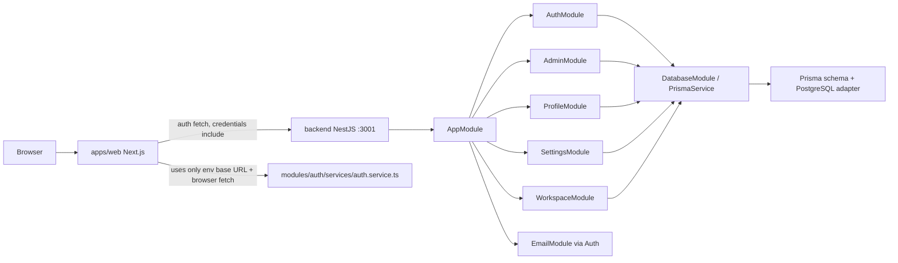

# HudaVerse Current Repository Structure

**Inspection date:** 2026-11-10  
**Repository:** `C:\Users\User\hudaverse`  
**Scope:** Read-only discovery. Only this report is newly written. Generated/dependency trees (`node_modules`, `.next`, `.git`, `dist`, `build`, `coverage`, `.turbo`) and local/tooling scratch trees (`.tmp`, `.vercel`) are excluded from the source tree listing. Environment files are not read or listed by filename where they may disclose local setup; only their safe template presence is stated.

## 1. Executive Summary

The repository is a pnpm/Turborepo monorepo with one implemented user-facing application (Next.js web) and one implemented NestJS API at root-level `backend/`. `apps/admin/` exists but is empty; there is no mobile app. Six backend feature modules are registered in the Nest root module: Admin, Auth, Email, Profile, Settings, Workspace. A frontend auth service exists under `apps/web/modules/auth`; no frontend shared workspace packages are implemented.

The current inspected source inventory contains **83 non-generated directories and 219 files** (environment files excluded). Counts include project documentation and configuration and reflect the exclusion policy above. `packages/{config,database,shared,ui}` are empty. Prisma schema and ten migration folders are present. Backend tests/specs exist; no dedicated frontend test directory was found.

## 2. Repository Overview

| Area | Path | Responsibility / status |
|---|---|---|
| Web application | `apps/web` | Implemented Next.js app; routes `/`, `/explore`, `/about`, `/login`. |
| Admin application | `apps/admin` | Directory exists, no files; not an implemented application. |
| Backend API | `backend` | Implemented NestJS API, Prisma schema, migrations and seed scripts. |
| Shared packages | `packages/{ui,database,shared,config}` | Four workspace package directories exist but are empty. |
| Documentation | `docs/audits` | Eight audit/review documents; documentation tree is not empty. |
| Docker / scripts | `docker`, `scripts` | Directories exist and are empty. |
| Root configuration | root | pnpm workspace, Turbo tasks and root package manifest. |

## 3. Complete Folder & File Tree

The listing below is the complete non-generated file inventory as relative paths. Empty directories are listed in §12. Paths are one per line to keep nesting unambiguous. `.tmp` contains local browser profiles, screenshots and probe artifacts and is excluded as scratch output. The root `.env`-style files are omitted for secret hygiene.

```text.gitignore
.vercelignore
AGENTS.md
AGENTS-02.md
apps\web\.gitignore
apps\web\app\about\page.tsx
apps\web\app\error.tsx
apps\web\app\explore\page.tsx
apps\web\app\favicon.ico
apps\web\app\fonts.ts
apps\web\app\global-error.tsx
apps\web\app\globals.css
apps\web\app\layout.tsx
apps\web\app\login\page.tsx
apps\web\app\not-found.tsx
apps\web\app\page.tsx
apps\web\app\styles\buttons.css
apps\web\app\styles\cards.css
apps\web\components\about\AboutPage.tsx
apps\web\components\auth\LoginVisualLab.tsx
apps\web\components\explore\EcosystemSection.tsx
apps\web\components\explore\ExploreAi.tsx
apps\web\components\explore\ExploreDay.tsx
apps\web\components\explore\ExploreHero.tsx
apps\web\components\explore\ExploreKnowledge.tsx
apps\web\components\explore\ExploreLearning.tsx
apps\web\components\explore\ExplorePersonalSpace.tsx
apps\web\components\explore\ExploreTrust.tsx
apps\web\components\home\AI.tsx
apps\web\components\home\CTA.tsx
apps\web\components\home\Download.tsx
apps\web\components\home\FAQ.tsx
apps\web\components\home\Features.tsx
apps\web\components\home\Hero.tsx
apps\web\components\home\PhoneMockup.tsx
apps\web\components\layout\Footer.tsx
apps\web\components\layout\LanguageSwitcher.tsx
apps\web\components\layout\navbar\DesktopNavbar.tsx
apps\web\components\layout\navbar\Logo.tsx
apps\web\components\layout\navbar\MobileNavbar.tsx
apps\web\components\layout\navbar\navbar.config.ts
apps\web\components\layout\navbar\Navbar.tsx
apps\web\components\system\SystemStatusPage.tsx
apps\web\components\ui\Button.tsx
apps\web\components\ui\IconButton.tsx
apps\web\eslint.config.mjs
apps\web\hooks\useCountUp.tsx
apps\web\hooks\useLanguage.ts
apps\web\hooks\useReducedMotion.ts
apps\web\hooks\useScroll.ts
apps\web\lib\ecosystem-navigation.ts
apps\web\lib\language.ts
apps\web\lib\utils.ts
apps\web\locales\about.types.ts
apps\web\locales\ar\about.ts
apps\web\locales\ar\explore.ts
apps\web\locales\ar\footer.ts
apps\web\locales\ar\landing.ts
apps\web\locales\ar\login.ts
apps\web\locales\ar\navbar.ts
apps\web\locales\ar\system-status.ts
apps\web\locales\bn\about.ts
apps\web\locales\bn\explore.ts
apps\web\locales\bn\footer.ts
apps\web\locales\bn\landing.ts
apps\web\locales\bn\login.ts
apps\web\locales\bn\navbar.ts
apps\web\locales\bn\system-status.ts
apps\web\locales\en\about.ts
apps\web\locales\en\explore.ts
apps\web\locales\en\footer.ts
apps\web\locales\en\landing.ts
apps\web\locales\en\login.ts
apps\web\locales\en\navbar.ts
apps\web\locales\en\system-status.ts
apps\web\locales\fa\about.ts
apps\web\locales\fa\explore.ts
apps\web\locales\fa\footer.ts
apps\web\locales\fa\landing.ts
apps\web\locales\fa\login.ts
apps\web\locales\fa\navbar.ts
apps\web\locales\fa\system-status.ts
apps\web\locales\tr\about.ts
apps\web\locales\tr\explore.ts
apps\web\locales\tr\footer.ts
apps\web\locales\tr\landing.ts
apps\web\locales\tr\login.ts
apps\web\locales\tr\navbar.ts
apps\web\locales\tr\system-status.ts
apps\web\locales\ur\about.ts
apps\web\locales\ur\explore.ts
apps\web\locales\ur\footer.ts
apps\web\locales\ur\landing.ts
apps\web\locales\ur\login.ts
apps\web\locales\ur\navbar.ts
apps\web\locales\ur\system-status.ts
apps\web\modules\auth\services\auth.service.ts
apps\web\next.config.ts
apps\web\package.json
apps\web\package-lock.json
apps\web\postcss.config.mjs
apps\web\public\Elegant Islamic Geometric Mosque Landscape.png
apps\web\public\erorr-page-bg.png
apps\web\public\explore-hero-bg.png
apps\web\public\explore-hero-bg-img.png
apps\web\public\file.svg
apps\web\public\globe.svg
apps\web\public\hero-mosque.png
apps\web\public\hero-phone.png
apps\web\public\hudaverse-logo-mark.png
apps\web\public\logo.png
apps\web\public\logo-icon.png
apps\web\public\next.svg
apps\web\public\vercel.svg
apps\web\public\window.svg
apps\web\README.md
apps\web\tsconfig.json
apps\web\web-structure.txt
backend\jest.config.js
backend\nest-cli.json
backend\package.json
backend\prisma.config.ts
backend\prisma\migrations\20260729190841_init_auth\migration.sql
backend\prisma\migrations\20260729193411_add_refresh_token\migration.sql
backend\prisma\migrations\20260801034154_add_email_verification\migration.sql
backend\prisma\migrations\20260801150331_add_password_reset_system\migration.sql
backend\prisma\migrations\20260801161441_add_user_role_compound_unique\migration.sql
backend\prisma\migrations\20260801175210_auth_session_upgrade\migration.sql
backend\prisma\migrations\20260802091539_add_user_settings\migration.sql
backend\prisma\migrations\20260802110908\migration.sql
backend\prisma\migrations\20260802121007_add_rbac_roles\migration.sql
backend\prisma\migrations\20260802145342_add_permission_system\migration.sql
backend\prisma\migrations\migration_lock.toml
backend\prisma\schema.prisma
backend\prisma\seed.ts
backend\prisma\seeds\founder.seed.spec.ts
backend\prisma\seeds\founder.seed.ts
backend\prisma\seeds\permissions.seed.ts
backend\src\app.module.ts
backend\src\config\app.config.ts
backend\src\config\env.validation.ts
backend\src\database\database.module.ts
backend\src\database\prisma.service.ts
backend\src\main.ts
backend\src\modules\admin\admin.controller.ts
backend\src\modules\admin\admin.module.ts
backend\src\modules\admin\admin.service.spec.ts
backend\src\modules\admin\admin.service.ts
backend\src\modules\admin\dto\update-user-role.dto.ts
backend\src\modules\admin\dto\update-user-status.dto.ts
backend\src\modules\admin\guards\admin.guard.ts
backend\src\modules\admin\interfaces\admin-response.interface.ts
backend\src\modules\auth\auth.controller.ts
backend\src\modules\auth\auth.module.ts
backend\src\modules\auth\auth.service.ts
backend\src\modules\auth\authenticated-principal.e2e.spec.ts
backend\src\modules\auth\constants.ts
backend\src\modules\auth\constants\role-hierarchy.ts
backend\src\modules\auth\cookies\cookie.service.ts
backend\src\modules\auth\decorators\permissions.decorator.ts
backend\src\modules\auth\decorators\roles.decorator.ts
backend\src\modules\auth\dto\forgot-password.dto.ts
backend\src\modules\auth\dto\login.dto.ts
backend\src\modules\auth\dto\refresh.dto.ts
backend\src\modules\auth\dto\register.dto.ts
backend\src\modules\auth\dto\resend-verification.dto.ts
backend\src\modules\auth\dto\reset-password.dto.ts
backend\src\modules\auth\dto\verify-email.dto.ts
backend\src\modules\auth\guards\jwt-auth.guard.ts
backend\src\modules\auth\guards\permissions.guard.ts
backend\src\modules\auth\guards\roles.guard.ts
backend\src\modules\auth\interfaces\authenticated-request.interface.ts
backend\src\modules\auth\interfaces\device-metadata.interface.ts
backend\src\modules\auth\jwt.payload.ts
backend\src\modules\auth\jwt-auth.guard.ts
backend\src\modules\auth\sessions\dto\delete-session.dto.ts
backend\src\modules\auth\sessions\session.controller.ts
backend\src\modules\auth\sessions\session.service.ts
backend\src\modules\auth\strategies\jwt.strategy.ts
backend\src\modules\auth\token.service.ts
backend\src\modules\email\email.module.ts
backend\src\modules\email\email.service.ts
backend\src\modules\profile\dto\update-profile.dto.ts
backend\src\modules\profile\profile.controller.spec.ts
backend\src\modules\profile\profile.controller.ts
backend\src\modules\profile\profile.module.ts
backend\src\modules\profile\profile.service.spec.ts
backend\src\modules\profile\profile.service.ts
backend\src\modules\settings\dto\update-settings.dto.ts
backend\src\modules\settings\settings.controller.spec.ts
backend\src\modules\settings\settings.controller.ts
backend\src\modules\settings\settings.module.ts
backend\src\modules\settings\settings.service.spec.ts
backend\src\modules\settings\settings.service.ts
backend\src\modules\workspace\dto\update-workspace.dto.ts
backend\src\modules\workspace\workspace.controller.ts
backend\src\modules\workspace\workspace.module.ts
backend\src\modules\workspace\workspace.service.ts
backend\tsconfig.build.json
backend\tsconfig.json
backend\tsconfig.spec.json
docs\audits\ABOUT_PAGE_FINAL_BUILD_AND_VISUAL_VERIFICATION.md
docs\audits\ABOUT_PAGE_FINAL_REVIEW.md
docs\audits\ABOUT_PAGE_VISUAL_AUDIT.md
docs\audits\AUDIT_00_MASTER_CHECKLIST.md
docs\audits\AUDIT_01_SECURITY_AND_DATA_INTEGRITY.md
docs\audits\HUDAVERSE_EXISTING_NAVBAR_INSPECTION.md
docs\audits\HUDAVERSE_LANDING_NAVBAR_SECTION_LINK_AUDIT.md
docs\audits\HUDAVERSE_PUBLIC_WEBSITE_NAVIGATION_AND_SECTION_AUDIT.md
docs\audits\HUDAVERSE-CURRENT-REPOSITORY-STRUCTURE.md
hudaverse-files.txt
missing-sections.txt
package.json
packages-details.txt
pnpm-lock.yaml
pnpm-workspace.yaml
STRUCTURE.md
targeted-inventory.txt
turbo.json```

## 4. Application Architecture

Only `apps/web` is a runnable application under `apps/`. `backend` is a separate NestJS workspace project and serves the API. `apps/admin` is empty. `apps/mobile`, `apps/api`, and `infrastructure` are absent. This differs from the target layout in project guidance, which describes mobile/admin and `apps/api`; this report records the repository as found and does not propose a move.

Platform flow observed: browser → web app; `apps/web/modules/auth/services/auth.service.ts` posts to `NEXT_PUBLIC_API_URL` (fallback `http://localhost:3001`) → Nest auth endpoints. Nest listens on port 3001 and currently allows credentialed CORS only from `http://localhost:3000`. Backend persistence path is feature services → `PrismaService` → PostgreSQL Prisma adapter/client configured using `DATABASE_URL` (variable name only; no value disclosed).

## 5. Frontend Architecture

`apps/web/app` uses the Next App Router directly (no `src/`). Routes found: landing `/`, `/explore`, `/about`, `/login`, plus framework error/not-found routes. `components/home`, `components/explore`, `components/about`, `components/auth`, `components/layout`, `components/system`, and `components/ui` hold UI. `hooks` contains four hooks; `lib` contains language, formatting/class utility and ecosystem-navigation helpers. `locales` includes `ar`, `bn`, `en`, `fa`, `tr`, `ur`, each with about/ explore/footer/landing/login/navbar/system-status message modules, plus `about.types.ts`.

The login route renders `LoginVisualLab`; auth service is separately located under `modules/auth/services`. It performs direct `fetch` calls and stores the access token in `sessionStorage`. No general API client or query/cache layer was found. No frontend `services/`, `types/` (apart from locale type), `store/`, or tests directory was found. CSS is in `app/globals.css` and `app/styles/{buttons,cards}.css`; component primitives are Button and IconButton. There is no shared design-system package.

## 6. Backend Architecture

Nest entry points: `backend/src/main.ts`, `backend/src/app.module.ts`. Registered modules: admin, auth, email, profile, settings, workspace. Feature folders generally contain controller/service/module and feature-local DTO/guards/interfaces/specs. `src/config` holds app config and environment validation. `src/database` contains `DatabaseModule` and `PrismaService`. `src/common`, `src/guards`, `src/middleware`, and `backend/tests` are empty.

| Module | Main files / responsibility | Connections |
|---|---|---|
| Auth | `auth.controller.ts`, `auth.service.ts`, `auth.module.ts`; registration/login/verification/password-reset/token/session flows; role/permission guards and JWT strategy. | DatabaseModule/Prisma; EmailModule; used by Profile, Settings, Workspace, Admin. |
| Admin | `admin.controller.ts`, `admin.service.ts`; user listing/status/role operations. | DatabaseModule, AuthModule; role/permission model. |
| Email | `email.module.ts`, `email.service.ts`; mail delivery abstraction. | Imported by AuthModule; Nodemailer dependency. |
| Profile | controller/service/DTO; profile reads and updates. | DatabaseModule, AuthModule. |
| Settings | controller/service/DTO; user settings reads/updates. | DatabaseModule, AuthModule. |
| Workspace | controller/service/DTO; workspace reads/updates. | DatabaseModule, AuthModule. |

The structure uses controller/service and direct PrismaService injections. A distinct repository layer is not present in the observed feature files, so the documented Controller → Service → Repository → Database layering is not consistently represented. Source imports reveal no confirmed circular module dependency; no formal cycle analysis tool was run.

## 7. Database Architecture

`backend/prisma/schema.prisma` is the single observed Prisma schema; `prisma.config.ts` points Prisma to it and obtains datasource URL from `DATABASE_URL`. `src/database/database.module.ts` provides/exports `PrismaService`; its implementation creates the Prisma client/adapter. Ten migration directories are present, plus `migration_lock.toml`; seed entrypoint `seed.ts` delegates to founder and permissions seeds. Schema/migrations cover account/auth/session/password reset, role and permission data, and user settings. No separate `packages/database` schema is implemented (that package directory is empty). No runtime database connection was exercised.

## 8. Shared Packages Architecture

Workspace package directories: `packages/config`, `packages/database`, `packages/shared`, `packages/ui` — **4 directories, 0 populated packages**. Root workspace includes `apps/*`, `packages/*`, and `backend`. The web package manifest does not declare these workspace packages as dependencies. Shared UI, common types/utilities and centralized configuration therefore currently live nowhere as a populated shared package; web UI/helpers are app-local.

## 9. Module Inventory

**Frontend module:** `auth` at `apps/web/modules/auth` (one service file, sign-in and password reset requests). Its dependency is browser `fetch`, environment-based API base URL, and sessionStorage. Other frontend groupings are component/page directories, not code-defined data/service modules.

**Backend modules:** six modules listed in §6. Connections are via Nest module imports and constructor injection. Auth is a common dependency of the other user/administrative modules; Prisma is the shared persistence dependency. Email is used by Auth. No Quran, Hadith, Tafsir, Fiqh, Library, Search, AI, Payment, Notification or standalone user module source folder was found.

Shared resource findings: UI primitives are `components/ui`; hooks are `apps/web/hooks`; locale type is `locales/about.types.ts`; app-local API service is the auth service; backend DB client is `PrismaService`; authorization is implemented in auth role/permission decorators and guards plus admin guard; web localization has six language directories. No cross-app shared types/client package exists.

## 10. Dependency & Connection Map



Frontend API URL is `process.env.NEXT_PUBLIC_API_URL ?? "http://localhost:3001"` in the auth service; auth paths are `/auth/login` and `/auth/forgot-password`. Nest CORS allowlist is currently localhost web origin in `main.ts`. Backend `DatabaseModule` is imported by feature modules and the Prisma service wraps persistence. No confirmed circular dependency was identified by inspecting module imports. Overlapping responsibilities: auth-specific JWT guard exists both at `auth/jwt-auth.guard.ts` and `auth/guards/jwt-auth.guard.ts`; workspace is a backend module without a corresponding app-level workspace UI/module in the inspected web tree. These are findings, not recommendations.

## 11. Configuration Inventory

| File | Finding |
|---|---|
| `package.json` | Root scripts `dev/build/lint` delegate through Turbo; package manager pnpm. |
| `pnpm-workspace.yaml` | Includes `apps/*`, `packages/*`, `backend`; pnpm build allowlist. |
| `pnpm-lock.yaml` | Root pnpm lockfile present. |
| `turbo.json` | Tasks: dev (persistent/no cache), build outputs `.next`/`dist`, lint, type-check. |
| `apps/web/package.json` | Next 16 / React 19 package, scripts dev/build/start/lint; UI libraries include Lucide, React Icons, Framer Motion. |
| `apps/web/package-lock.json` | Separate npm lockfile also present alongside root pnpm workspace. |
| `apps/web/next.config.ts` | Standalone output, image formats/sizes, package optimization, production console filtering and security headers. |
| `apps/web/tsconfig.json` | Web TypeScript config present. |
| `backend/package.json` | Nest scripts, Jest, Prisma seed, dependencies for Nest, Prisma, PostgreSQL, validation, JWT and mail. |
| `backend/nest-cli.json`, `backend/jest.config.js` | Nest CLI and Jest configuration. |
| `backend/tsconfig.json`, `tsconfig.build.json`, `tsconfig.spec.json` | Backend compiler configs. |
| `backend/prisma.config.ts` | Prisma schema, datasource env key and seed command. |
| `backend/prisma/schema.prisma` | Database schema. |
| `backend/.env.example` | Template exists (presence confirmed; values/contents not reported). Local `.env` and web local env file exist but are intentionally excluded and not inspected. |
| `apps/web/eslint.config.mjs`, `postcss.config.mjs` | Web lint and CSS pipeline config. |
| `AGENTS.md`, `AGENTS-02.md`, `STRUCTURE.md` | Project truth/rules and prior inventory; current findings here supersede stale implementation snapshots for this inspection. |

No root `tsconfig.json` or root `.env.example` was found. No `docker-compose`/Compose config was found under `docker/` (empty). No API URL proxy/rewrite is configured in Next config.

## 12. Empty & Missing Directories

**Empty directories (11):** `apps/admin`; `backend/src/common`; `backend/src/guards`; `backend/src/middleware`; `backend/tests`; `docker`; `packages/config`; `packages/database`; `packages/shared`; `packages/ui`; `scripts`.

**Expected by project guidance but absent/unpopulated:** `apps/mobile`, `apps/api` (API currently at `backend`), populated `apps/admin`, populated shared packages, `infrastructure`, root `design-system`, web `services`, `store`, full web `types`, frontend tests, backend repositories and standalone controller/service layers. These are absent relative to the documented target; not asserted as defects.

**Directories without clear responsibility / ownership:** `apps/web/modules/auth` is a module-local service-only structure while page/UI lives in `components/auth`; `backend/src/modules/email` is an infrastructure-style module, but is intentionally imported as a backend feature module. `backend/src/common`, guards and middleware exist empty. Root inventory helper text files (`hudaverse-files.txt`, `missing-sections.txt`, `packages-details.txt`, `targeted-inventory.txt`) have no source-code ownership implied by their names.

**Potential duplication/overlap:** duplicate-location JWT auth guard implementation files noted in §10; root pnpm lock plus app npm lock; API authentication service exists in frontend and backend as expected client/server counterparts, but there is no generated/shared API contract. No other duplicate directory responsibility confirmed.

## 13. Structural Observations

- The codebase is an early partial monorepo: one web app and one backend service, with empty placeholders for admin/shared packages.
- Web is organized by routes and presentational components; backend is organized into feature modules, but services call Prisma directly rather than using repositories.
- API version prefix was not observed in the inspected Nest bootstrap/controllers; CORS is set for one localhost origin.
- Frontend auth transport is the only explicit API client found; no centralized client or shared API types were located.
- Six locales are present. The app has one auth feature service; product knowledge modules are not implemented in source tree.
- Tests/specs are present in backend feature folders and Prisma seeds; frontend test structure absent.
- `STRUCTURE.md` describes an older inventory date and misses current About/Login routes, frontend auth module and populated audit docs. The current report should be used for this inspection date.

## 14. Items Requiring Further Investigation

- Confirm intended package-manager policy because both root pnpm and web npm lockfiles exist.
- Decide whether `apps/admin` and four package directories are intentionally reserved placeholders.
- Review whether both JWT guard files are meant to differ or are legacy overlap.
- Trace the complete login cookie/token lifecycle across client/backend and validate deployment origins; this inventory did not execute requests or inspect secret values.
- Confirm which Prisma migration corresponds to the directory with timestamp `20260802110908` and verify migration/schema consistency if a future database audit is requested.
- Determine whether empty backend common/guards/middleware/tests directories are intentional.
- Compare current Landing/Explore route composition with locked design notes only if a separate design audit is requested.


